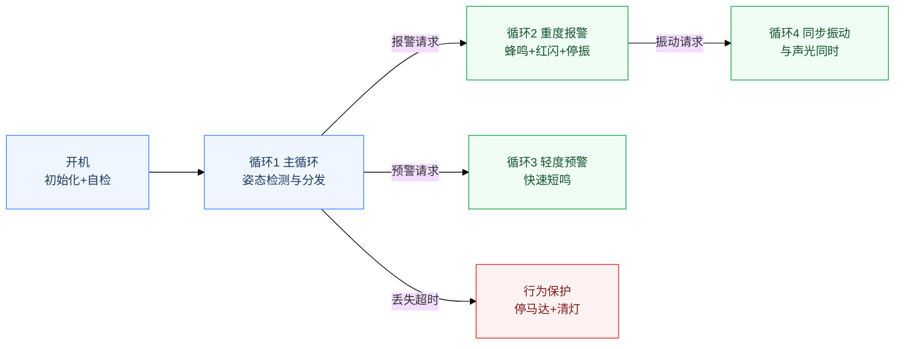
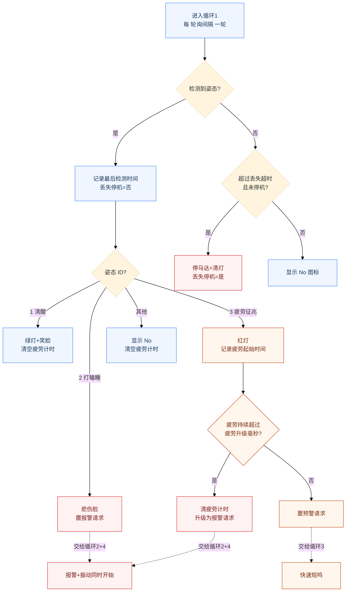
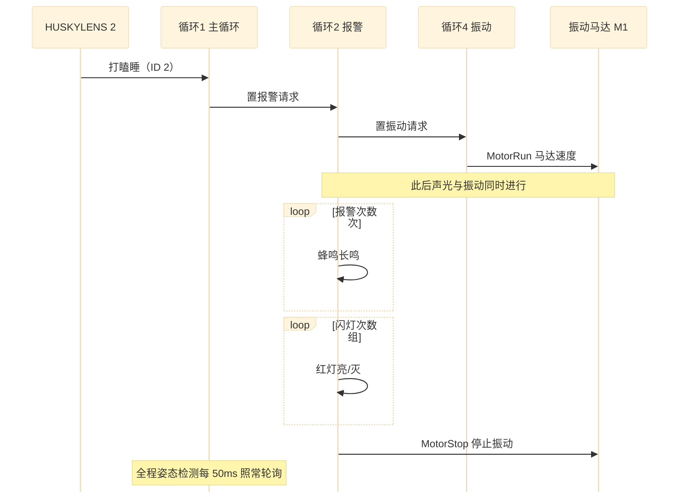

# 司机打瞌睡识别报警系统

> **在线介绍网站**：<https://gsjsjzhznsz.github.io/driver/> —— 中英双语、跟随浏览器语言，三张 Mermaid 流程图实时渲染。

基于 **micro:bit + RobotBit 扩展板 + HUSKYLENS 2** 的司机疲劳驾驶检测与报警程序。HUSKYLENS 2 识别司机姿态，识别到"打瞌睡"或"疲劳征兆"时，通过 **蜂鸣、红灯闪烁、方向盘振动马达** 三路同时报警；全程姿态检测不中断，并带有丢失保护与疲劳升级等安全机制。

## 功能特性

- **姿态识别报警**：HUSKYLENS 2 姿态算法，三个姿态 ID 对应三种状态
  - `ID 1` 清醒 → 绿灯 + 笑脸
  - `ID 2` 打瞌睡 → 重度报警（长鸣 + 红闪 + 振动）
  - `ID 3` 疲劳征兆 → 轻度预警（快速短鸣）
- **振动与警报同时进行**：报警开始时振动马达立即启动，与蜂鸣、闪灯并行，报警结束自动停止
- **检测永不卡顿**：报警/预警/振动在三个独立后台循环执行，主循环每 50ms 照常轮询姿态（旧版单循环会被报警动作阻塞最长约 10 秒）
- **疲劳升级**（新功能）：疲劳征兆持续超过 `疲劳升级毫秒` 仍未恢复，自动升级为重度报警
- **开机自检**（新功能）：上电后短鸣一声、绿灯亮 0.5 秒，表示初始化完成；若自检一直不响，说明 HUSKYLENS 未连好
- **丢失保护**：连续 `丢失超时` 检测不到司机，自动停马达并清灯（只执行一次），防止无人驾驶车辆失控
- **参数化**：11 个可调参数全部集中在开机初始化区，改数值即可调行为
- **积木便签注释**（新功能）：积木视图关键位置带中文便签说明，JS 视图同步中文注释

## 硬件清单

| 硬件 | 数量 | 用途 |
| --- | --- | --- |
| micro:bit 主板 | 1 | 主控 |
| RobotBit 扩展板 | 1 | 马达驱动 / 板载 RGB 灯（P16，4 颗）/ 板载蜂鸣器 |
| HUSKYLENS 2 AI 摄像头 | 1 | 姿态识别 |
| 方向盘振动马达 | 1 | 报警时振动方向盘提醒司机 |
| 18650 电池 | 1 | RobotBit 供电 |

## 接线说明

- **HUSKYLENS 2** → micro:bit I2C 引脚：`P19`（SCL）、`P20`（SDA），接 RobotBit 的 I2C 座即可
- **方向盘振动马达** → RobotBit `M1` 接线端子（代码使用 `Motors.M1A`）
- **蜂鸣器 / RGB 灯** → 使用 RobotBit 板载件，无需接线
- 供电：装好 18650 电池后用 RobotBit 的电源开关开机

## HUSKYLENS 2 姿态训练

1. 打开 HUSKYLENS 2，进入（或切换到）**姿态识别** 算法
2. 对准司机的**清醒姿态**（如端正坐姿），学习并保存为 **ID 1**
3. 对准**打瞌睡姿态**（低头/闭眼），学习并保存为 **ID 2**
4. 对准**疲劳征兆姿态**（频繁点头/揉眼等过渡姿态），学习并保存为 **ID 3**
5. 建议每个姿态在多种光线、角度下多次学习，提高识别稳定性

> 具体按键与菜单位置以 HUSKYLENS 2 固件实际界面为准。

## 程序结构

代码由 **1 个开机初始化块 + 4 个并行循环** 组成，循环之间通过"请求标志"通信，互不阻塞。

### 可调参数（开机初始化区）

| 参数 | 默认值 | 说明 |
| --- | --- | --- |
| `报警音调` | 262 | 报警长鸣音调（Hz） |
| `报警次数` | 3 | 报警长鸣次数（每次约 1 秒） |
| `闪灯次数` | 2 | 红灯闪烁组数（亮+灭为一组） |
| `闪灯间隔` | 500 | 红灯亮/灭时长（毫秒） |
| `马达速度` | 255 | 方向盘振动马达速度（0~255，数值越大振动越强） |
| `预警音调` | 262 | 预警快滴音调（Hz） |
| `预警次数` | 3 | 预警快滴次数（每次约 0.5 秒） |
| `轮询间隔` | 50 | 姿态轮询间隔（毫秒） |
| `丢失超时` | 5000 | 连续检测不到司机多久后停机（毫秒） |
| `疲劳升级毫秒` | 10000 | 疲劳征兆持续多久后升级为重度报警（毫秒） |
| 自检绿灯时长 | 500 | 开机自检绿灯亮起时长（毫秒，写在自检积木里） |

### 运行状态变量（程序自动维护，无需修改）

| 变量 | 作用 |
| --- | --- |
| `动作中` | 有报警/预警动作正在后台执行（此时主循环只检测、不重复派发） |
| `报警请求` / `预警请求` / `振动请求` | 循环 1 → 循环 2/3/4 的任务请求标志 |
| `丢失停机` | 已因丢失姿态而停机，避免重复执行停机动作 |
| `首次疲劳时间` | 疲劳征兆首次出现的时间，用于持续计时升级 |
| `最后检测时间` | 最近一次检测到姿态的时间，用于丢失判断 |

### 四个并行循环

| 循环 | 职责 | 节奏 |
| --- | --- | --- |
| 循环 1 · 主循环 | 读取姿态 → 按 ID 亮灯 → 派发报警/预警请求 → 丢失保护 → 疲劳升级判断 | 每 `轮询间隔`（50ms）一轮 |
| 循环 2 · 重度报警 | 蜂鸣 + 红灯闪烁，结束时停止振动 | 有报警请求时执行 |
| 循环 3 · 轻度预警 | 快速短鸣 | 有预警请求时执行 |
| 循环 4 · 同步振动 | 与报警声光同时启动方向盘振动马达 | 有振动请求时执行 |

## 工作流程图

### 1. 系统总览

### 2. 主循环详细流程（检测 / 分发 / 升级 / 丢失保护）

### 3. 重度报警动作时序（振动与警报同时进行）

## 使用方法

1. 打开 [makecode.microbit.org](https://makecode.microbit.org/)
2. 点击 **导入** → **导入 URL**，粘贴 `https://github.com/Gsjsjzhznsz/driver` 并导入
3. 积木视图中，**带黄色便签图标的积木**可点开查看中文说明；画布上（on start 积木下方）还有一条黄色项目总览便签
4. 下载 `.hex` 到 micro:bit，装上 RobotBit 与 HUSKYLENS 2 即可运行
5. 若浏览器中打开的还是旧版项目，请 **导入 → 从 GitHub 重新导入一次**（MakeCode 会缓存已打开的项目）

> 提示：在积木视图右键任意积木 →"添加备注"，可以继续补充自己的注释；切换到 JS 视图后注释会同步保留。

## 二次开发建议

- **换振动端口**：方向盘振动马达目前接 `M1`，如接其他端口，把积木中的 `Motors.M1A` 改为对应端口即可
- **预警升级策略**：调节 `疲劳升级毫秒`（默认 10 秒）可改变升级灵敏度；也可改成"连续 N 次疲劳征兆"的计数式升级
- **更多输出**：可在循环 2 中加入无线电通知（`radio`），把报警状态发给随车监护设备
- **记录数据**：利用 micro:bit 数据记录（datalogger）扩展记录每次报警时间，便于事后分析

#### 元数据（用于搜索、渲染）

* for PXT/microbit

