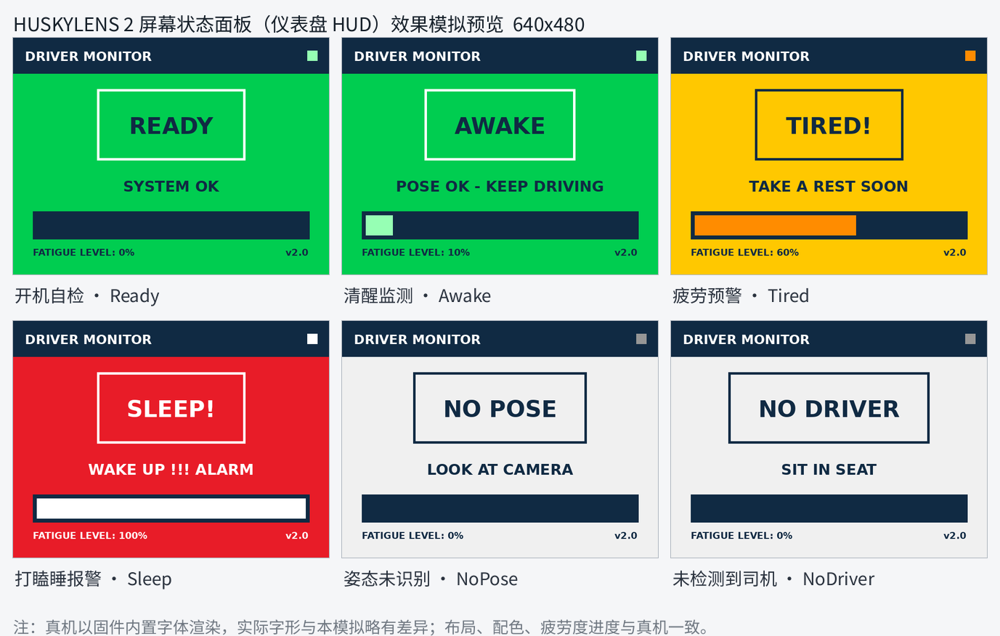
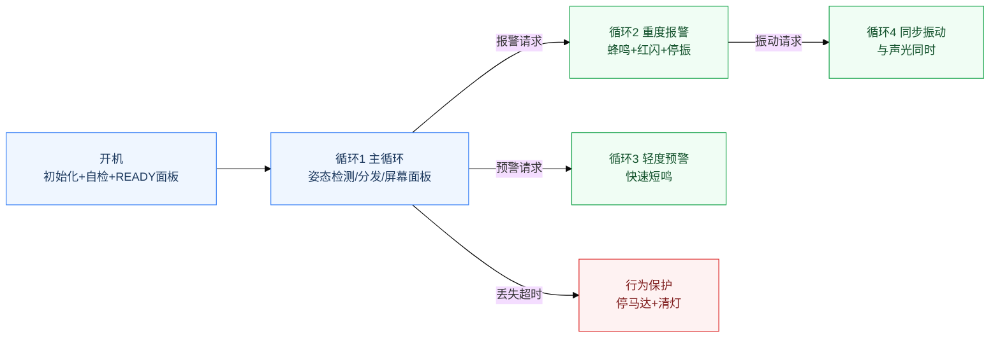
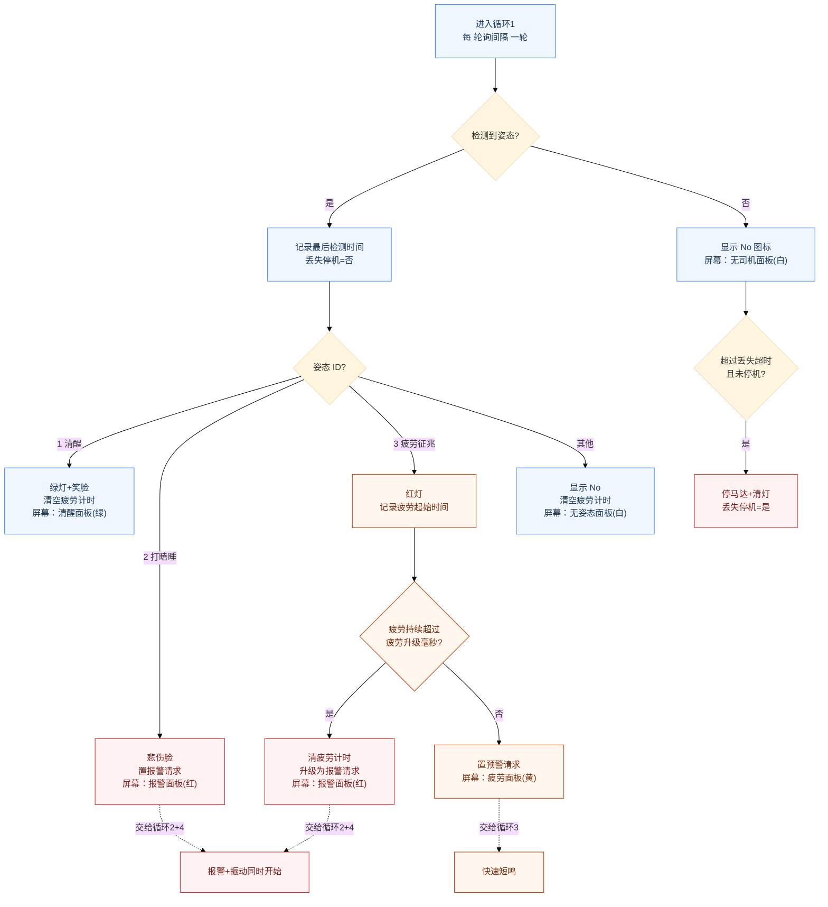

# 司机打瞌睡识别报警系统

> **在线介绍网站**：<https://gsjsjzhznsz.github.io/driver/> —— 中英双语、跟随浏览器语言，三张 Mermaid 流程图实时渲染。

基于 **micro:bit + RobotBit 扩展板 + HUSKYLENS 2** 的司机疲劳驾驶检测与报警程序。HUSKYLENS 2 识别司机姿态，识别到"打瞌睡"或"疲劳征兆"时，通过 **蜂鸣、红灯闪烁、方向盘振动马达** 三路同时报警，并在 **HUSKYLENS 屏幕**上实时显示当前状态；全程姿态检测不中断，并带有丢失保护与疲劳升级等安全机制。

## 功能特性

- **姿态识别报警**：HUSKYLENS 2 姿态算法，三个姿态 ID 对应三种状态
  - `ID 1` 清醒 → 绿灯 + 笑脸
  - `ID 2` 打瞌睡 → 重度报警（长鸣 + 红闪 + 振动）
  - `ID 3` 疲劳征兆 → 轻度预警（快速短鸣）
- **振动与警报同时进行**：报警开始时振动马达立即启动，与蜂鸣、闪灯并行，报警结束自动停止
- **屏幕状态面板（仪表盘 HUD，本次升级）**：HUSKYLENS 2 摄像头屏幕显示**仪表盘式状态面板**——深蓝标题栏（DRIVER MONITOR + 状态指示灯）+ 白描边卡片内 48 号大写英文状态大字（READY / AWAKE / TIRED! / SLEEP! / NO POSE / NO DRIVER）+ 提示副标题 + **疲劳度仪表条**（深蓝底、状态色进度：清醒 10% / 疲劳 60% / 打瞌睡 100%）+ 页脚读数，绿/黄/红/白整屏配色，展览现场远距离一眼可辨；面板内部自动判重（状态不变不重绘、每 60 秒自愈刷新），不拖慢 50ms 轮询。项目内置 `screenfix.ts` 自行组包并 **32 字节分块发送**，支持新旧两代固件的字节布局（积木可选），详见下文
- **检测永不卡顿**：报警/预警/振动在三个独立后台循环执行，主循环每 50ms 照常轮询姿态（旧版单循环会被报警动作阻塞最长约 10 秒）
- **疲劳升级**（新功能）：疲劳征兆持续超过 `疲劳升级毫秒` 仍未恢复，自动升级为重度报警
- **开机自检**（新功能）：上电后短鸣一声、绿灯亮 0.5 秒，表示初始化完成；若自检一直不响，说明 HUSKYLENS 未连好
- **丢失保护**：连续 `丢失超时` 检测不到司机，自动停马达并清灯（只执行一次），防止无人驾驶车辆失控
- **参数化**：11 个可调参数全部集中在开机初始化区，改数值即可调行为
- **积木便签注释**（新功能）：积木视图关键位置带中文便签说明，JS 视图同步中文注释

## 硬件清单

| 硬件 | 数量 | 用途 |
| --- | --- | --- |
| micro:bit 主板 | 1 | 主控 |
| RobotBit 扩展板 | 1 | 马达驱动 / 板载 RGB 灯（P16，4 颗）/ 板载蜂鸣器 |
| HUSKYLENS 2 AI 摄像头 | 1 | 姿态识别 |
| 方向盘振动马达 | 1 | 报警时振动方向盘提醒司机 |
| 18650 电池 | 1 | RobotBit 供电 |

## 接线说明

- **HUSKYLENS 2** → micro:bit I2C 引脚：`P19`（SCL）、`P20`（SDA），接 RobotBit 的 I2C 座即可
- **方向盘振动马达** → RobotBit `M1` 接线端子（代码使用 `Motors.M1A`）
- **蜂鸣器 / RGB 灯** → 使用 RobotBit 板载件，无需接线
- 供电：装好 18650 电池后用 RobotBit 的电源开关开机

## HUSKYLENS 2 姿态训练

1. 打开 HUSKYLENS 2，进入（或切换到）**姿态识别** 算法
2. 对准司机的**清醒姿态**（如端正坐姿），学习并保存为 **ID 1**
3. 对准**打瞌睡姿态**（低头/闭眼），学习并保存为 **ID 2**
4. 对准**疲劳征兆姿态**（频繁点头/揉眼等过渡姿态），学习并保存为 **ID 3**
5. 建议每个姿态在多种光线、角度下多次学习，提高识别稳定性

> 具体按键与菜单位置以 HUSKYLENS 2 固件实际界面为准。

## 程序结构

代码由 **1 个开机初始化块 + 4 个并行循环** 组成，循环之间通过"请求标志"通信，互不阻塞。另有独立文件 `screenfix.ts` 负责屏幕命令的协议组包与状态面板（HUD）绘制。

### 可调参数（开机初始化区）

| 参数 | 默认值 | 说明 |
| --- | --- | --- |
| `报警音调` | 988 | 报警长鸣音调（Hz） |
| `报警次数` | 3 | 报警长鸣次数（每次约 1 秒） |
| `闪灯次数` | 2 | 红灯闪烁组数（亮+灭为一组） |
| `闪灯间隔` | 500 | 红灯亮/灭时长（毫秒） |
| `马达速度` | 255 | 方向盘振动马达速度（0~255，数值越大振动越强） |
| `预警音调` | 900 | 预警快滴音调（Hz） |
| `预警次数` | 3 | 预警快滴次数（每次约 0.5 秒） |
| `轮询间隔` | 50 | 姿态轮询间隔（毫秒） |
| `丢失超时` | 5000 | 连续检测不到司机多久后停机（毫秒） |
| `疲劳升级毫秒` | 10000 | 疲劳征兆持续多久后升级为重度报警（毫秒） |
| 自检绿灯时长 | 500 | 开机自检绿灯亮起时长（毫秒，写在自检积木里） |

### 运行状态变量（程序自动维护，无需修改）

| 变量 | 作用 |
| --- | --- |
| `动作中` | 有报警/预警动作正在后台执行（此时主循环只检测、不重复派发） |
| `报警请求` / `预警请求` / `振动请求` | 循环 1 → 循环 2/3/4 的任务请求标志 |
| `丢失停机` | 已因丢失姿态而停机，避免重复执行停机动作 |
| `首次疲劳时间` | 疲劳征兆首次出现的时间，用于持续计时升级 |
| `最后检测时间` | 最近一次检测到姿态的时间，用于丢失判断 |

### 四个并行循环

| 循环 | 职责 | 节奏 |
| --- | --- | --- |
| 循环 1 · 主循环 | 读取姿态 → 按 ID 亮灯 → 更新屏幕面板 → 派发报警/预警请求 → 丢失保护 → 疲劳升级判断 | 每 `轮询间隔`（50ms）一轮 |
| 循环 2 · 重度报警 | 蜂鸣 + 红灯闪烁，结束时停止振动 | 有报警请求时执行 |
| 循环 3 · 轻度预警 | 快速短鸣 | 有预警请求时执行 |
| 循环 4 · 同步振动 | 与报警声光同时启动方向盘振动马达 | 有振动请求时执行 |

### HUSKYLENS 2 屏幕状态显示（观众可视）

#### 屏幕参数（来自官方协议文档）

| 参数 | 值 |
| --- | --- |
| 屏幕坐标系 | 640 × 480 像素，原点在左上角，`x` 范围 0~640、`y` 范围 0~480 |
| 支持字号 | 20 / 24 / 26 / 27 / 28 / 32 / 36 / 40 / 48（本项目用 **48 号状态大字 + 32 号副标题 + 28 号标题栏 + 20 号页脚**） |
| 支持字符 | 仅 ASCII/Latin 字形（固件不含中文，画中文会乱码——本项目因此全部使用英文大写） |
| 文字颜色 | 24 位 RGB（本项目结构色深蓝 `0x102A43`，状态底色绿 `0x00CD50` / 黄 `0xFFC800` / 红 `0xE81C28` / 浅灰白 `0xF0F0F0`） |
| 通信方式 | I2C（地址 `0x50`），命令 `0x26 画矩形` / `0x27 清矩形` / `0x28 画文字` / `0x29 清文字` |
| 显示位置 | **整屏状态面板（仪表盘 HUD）**：标题栏 + 大字卡片 + 疲劳度仪表条，展览现场远距离一眼可辨 |

#### 重要：屏幕不显示/显示 0/中文乱码的排查结论（四层问题叠加）

真机排查发现，屏幕"完全无显示""JS 代码全是 0""中文变乱码"是**四层问题叠加**，缺一不可：

1. **积木数值丢失（最终确认的根因）**：生成器在带限位的数字槽里使用了 `math_number_minmax` shadow，MakeCode 载入这种 XML 时解析失败，会把颜色/字号/坐标全部反编译成 **0**——积木视图显示 0、JavaScript 视图也是 0，烧录到真机后画的是"**黑色 0 号字**"，看起来就是"显示 0"或完全看不见。修复后改用普通 `math_number` shadow（与 MakeCode 官方保存格式一致），并已通过浏览器实测确认导入后数值全部正确（988/900/48/8/4 等）。
2. **I2C 传输层 32 字节限制**：DFRobot 官方库 `ProtocolV2.cpp` 的 `protocolWrite()` 会把超过 **32 字节**的包拆成 32 字节一块、块间停 5ms 分多次 I2C 事务发送（小内存板配置 `MAX_PL_LEN=32`），固件按块接收；扩展却整包一次性直写，超限时多余字节被**静默丢弃**。中文状态文字的画字包为 **39~44 字节全部超限**——而切算法（20 字节）、取结果（6 字节）等短命令一直正常，与"识别报警都在工作、唯独屏幕全黑"的现象完全吻合。
3. **数据布局随固件版本不同**：官方协议文档 V0.4（2026-10-29）把画文字命令的数据段定为"**RGBA 颜色在文字之前**"，而此前出厂固件采用的是扩展 v1.1.7 配对的旧布局"**文字在前、颜色在后**"。两种布局互不兼容，用错一代固件布局就会解析出乱码或空文本。
4. **字符集（本次修复）**：固件 `0x28` 画文字命令的字体**只含 ASCII/Latin 字形**——官方示例 `Draw.ino` 只画 `"DFRobot Test"`，协议文档也只在"设置已学习 ID 名称"一节标注支持中文（UTF-8），画文字命令没有任何中文支持说明。分块与布局修通后真机实测：中文仍被固件**按字节**画成 `*K0 P0~vM` 之类的乱码（每个 UTF-8 字节映射成一个不相干字形）。因此屏幕文字全部改用**大写英文单词**，中文状态语义交给整屏颜色（绿=清醒、黄=疲劳、红=打瞌睡、白=未检测到）与 micro:bit 点阵、RGB 灯共同表达。

因此项目新增 `screenfix.ts` 文件，一次性解决四层问题：

- **双协议布局**：积木"屏幕固件协议"可选 **旧版固件（2026-10 前出厂，默认）** / **新版固件（官方协议 V0.4）**，分别对应两代固件的字节布局；
- **32 字节分块发送**：块间停 5ms，与官方库 `protocolWrite()` 行为完全一致；
- **KNOCK 握手**：首次屏幕命令前先发送官方握手命令（boardType=0 小内存板），对齐官方库 `begin()` 流程；
- **纯 ASCII 文字**：状态文字全部为英文大写（固件字体不含中文字形，中文会画成乱码）；
- **应答解析**：每条命令后轮询读取固件 `RETURN_ARGS(0x1A)` 应答帧并校验 `retValue`，保持 I2C 应答通道干净。

提供四个可靠的自定义积木：

- `屏幕状态面板`（`ScreenFix.showPanel`）：**一键显示整屏状态面板（仪表盘 HUD）**，下拉选择 6 种面板（开机/清醒/疲劳/打瞌睡/无姿态/无司机）；布局、配色、疲劳度全部在面板内部实现，并自动判重（状态不变不重绘、60 秒周期自愈刷新）；主循环每个状态只需这一块积木
- `屏幕填满颜色`（`ScreenFix.fillRect`，面板内部使用）：发送 `0x27` 清除旧矩形 + 两条 `0x26` 画矩形命令，用**两层线宽 255 的嵌套矩形**（外框 0,0,640,480 + 内框 128,128,384,224）把整屏铺满状态色——无论固件把描边画在边线内侧还是居中，两层相加都必然覆盖整屏
- `屏幕清空文字`（`ScreenFix.clearText`，面板内部使用）：发送 `0x29` 清除所有文字
- `屏幕画文字 颜色 字号 x y 文字`（`ScreenFix.drawText`，面板内部使用）：发送 `0x28` 在指定位置画文字；字号/坐标会自动夹紧到合法值（**字号必须是 20~48 档位**，手填 0 固件会拒绝不画）

已通过协议级仿真验证：模拟器内置虚拟固件的逐字节接收状态机、32 字节事务上限、新旧双布局解析与 RETURN_ARGS 应答，全部 40+ 项断言通过（状态序列、标题/副标题颜色与坐标、满屏铺色的两层嵌套矩形参数、分块完整性、KNOCK 握手次数、命令/应答一一对应等）。

> 提示：若更新到本版本后屏幕仍无显示，请用积木"屏幕固件协议"切换另一代布局试一试（出厂固件大概率是旧版布局；若你在设备"设置 → 设备信息"里确认升级过 2026-10-29 之后的固件，请改为"新版固件（官方协议V0.4）"）。

#### 整屏状态面板（仪表盘 HUD）

主循环在状态变化时只调用一块 `屏幕状态面板` 积木，面板内部按固定版式绘制整屏（屏幕 640×480，文字居中估宽公式 `x=(640-字符数×0.6×字号)/2`）：

```text
■ 深蓝标题栏   DRIVER MONITOR ● 指示灯      ← 28号字 + 20×20 状态灯方块

       ┌── 白描边卡片 ──┐                    ← 卡片宽度随大字自适应
       │    AWAKE     │                    ← 48号状态大字
       └───────────────┘
       POSE OK - KEEP DRIVING                ← 32号副标题

▓▓░░░░░░░░░░░░░░░░  疲劳度仪表条             ← 深蓝底 + 状态色进度
FATIGUE LEVEL: 10%                    v2.0   ← 20号页脚读数与版本号
```

六个面板的效果模拟（真机以固件内置字体渲染，字形与模拟略有差异）：



| 面板（状态大字 / 副标题） | 中文含义 | 整屏配色 | 疲劳度 | 触发条件 |
| --- | --- | --- | --- | --- |
| READY / SYSTEM OK | 监测中·系统就绪 | 绿底 + 白卡片描边 | 0% | 开机自检完成，等待识别 |
| AWAKE / POSE OK - KEEP DRIVING | 司机清醒·监测中 | 绿底 + 白卡片描边，亮绿进度 | 10% | 识别到 ID 1（清醒姿态） |
| TIRED! / TAKE A REST SOON | 疲劳预警·请休息 | 黄底 + 深蓝卡片描边，橙色进度 | 60% | 识别到 ID 3（疲劳征兆，尚未升级） |
| SLEEP! / WAKE UP !!! ALARM | 打瞌睡报警·快醒 | 红底 + 白卡片描边，白色进度 | 100% | 识别到 ID 2，或 ID 3 持续超时升级为重度报警 |
| NO POSE / LOOK AT CAMERA | 姿态未识别 | 浅灰白底 + 深蓝描边 | 0% | 画面中有姿态但不匹配已学习的 ID |
| NO DRIVER / SIT IN SEAT | 未检测到司机 | 浅灰白底 + 深蓝描边 | 0% | 画面丢失（离开画面/遮挡） |

> 为什么用英文大字：HUSKYLENS 2 固件的画文字字体不含中文字形，中文会被按字节画成乱码（见上文第 4 层排查）；整屏状态色（绿/黄/红/白）才是观众最先感知的信号，英文大写词作为辅助标注，仪表条与读数再给出量化疲劳度，远距离一眼可辨。

刷新策略：面板**内部自动判重**——状态不变且 60 秒内刷新过则直接返回，稳定状态下不产生任何屏幕 I2C 通信，不影响 50ms 轮询节奏；每 60 秒强制重绘一次，若相机中途断电重启也能自动恢复画面。报警执行期间主循环照常轮询但不改屏，红色"SLEEP!"报警面板在整个报警过程中保持显示。

## 工作流程图

### 1. 系统总览



### 2. 主循环详细流程（检测 / 分发 / 升级 / 丢失保护）



### 3. 重度报警动作时序（振动与警报同时进行）


## 使用方法

1. 打开 [MakeCode 编辑器](https://makecode.microbit.org/)
2. 点击 **导入** → **导入 URL**，粘贴 `https://github.com/Gsjsjzhznsz/driver` 并导入
3. 积木视图中，**带黄色便签图标的积木**可点开查看中文说明；画布上（on start 积木下方）还有一条黄色项目总览便签
4. 下载 `.hex` 到 micro:bit，装上 RobotBit 与 HUSKYLENS 2 即可运行
5. 若浏览器中打开的还是旧版项目，请 **导入 → 从 GitHub 重新导入一次**（MakeCode 会缓存已打开的项目）

> 展览提示：报警时蜂鸣 + 振动马达瞬间电流较大，请使用**满电的 18650 电池**或外接电源；电量不足会导致主板复位、摄像头掉线，看起来像"卡住"（本程序已带丢失保护，重新上电即自动恢复）。

> 提示：在积木视图右键任意积木 →"添加备注"，可以继续补充自己的注释；切换到 JS 视图后注释会同步保留。

## 二次开发建议

- **换振动端口**：方向盘振动马达目前接 `M1`，如接其他端口，把积木中的 `Motors.M1A` 改为对应端口即可
- **自定义屏幕提示**：面板大字/副标题/配色/疲劳度集中在 `screenfix.ts` 的 `showPanel` 内（改 `big = "..."` / `sub = "..."` 与各状态配色即可，文字必须 ASCII）；需要整屏自定义画面时仍可用低层积木 `屏幕填满颜色` / `屏幕画文字`（屏幕 640×480，字号 20~48，居中公式：`x=(640-字符数×0.6×字号)/2`）；若需修改发送协议本身，请编辑 `screenfix.ts`（注意保持官方协议的字节顺序，且发送必须保持 **32 字节分块 + 块间延时**，整包直发超限字节会被固件丢弃）
- **预警升级策略**：调节 `疲劳升级毫秒`（默认 10 秒）可改变升级灵敏度；也可改成"连续 N 次疲劳征兆"的计数式升级
- **更多输出**：可在循环 2 中加入无线电通知（`radio`），把报警状态发给随车监护设备
- **记录数据**：利用 micro:bit 数据记录（datalogger）扩展记录每次报警时间，便于事后分析

#### 元数据（用于搜索、渲染）

* for PXT/microbit
<script src="https://makecode.com/gh-pages-embed.js"></script><script>makeCodeRender("{{ site.makecode.home_url }}", "{{ site.github.owner_name }}/{{ site.github.repository_name }}");</script>
