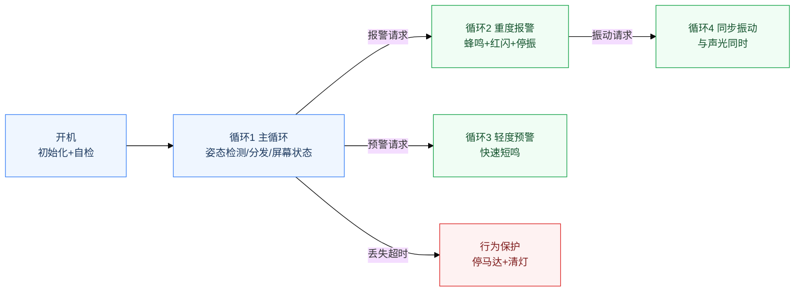
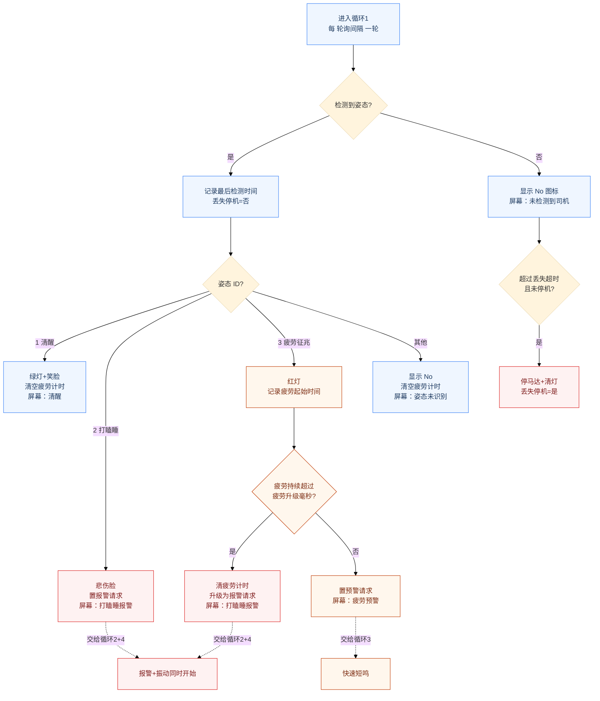
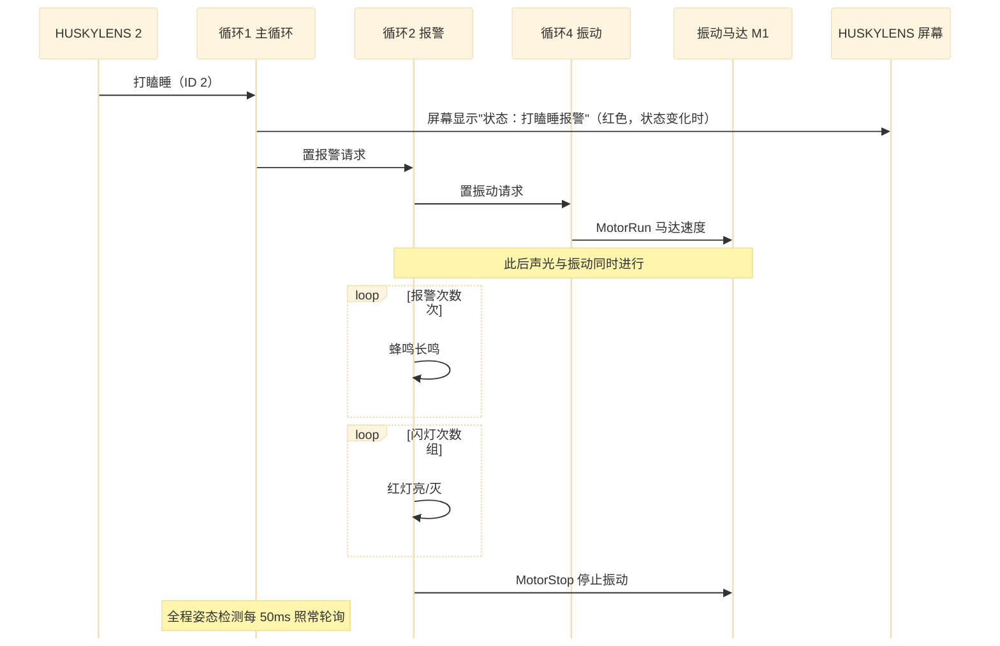

# 司机打瞌睡识别报警系统

> **在线介绍网站**：<https://gsjsjzhznsz.github.io/driver/> —— 中英双语、跟随浏览器语言，三张 Mermaid 流程图实时渲染。

基于 **micro:bit + RobotBit 扩展板 + HUSKYLENS 2** 的司机疲劳驾驶检测与报警程序。HUSKYLENS 2 识别司机姿态，识别到"打瞌睡"或"疲劳征兆"时，通过 **蜂鸣、红灯闪烁、方向盘振动马达** 三路同时报警，并在 **HUSKYLENS 屏幕**上实时显示当前状态；全程姿态检测不中断，并带有丢失保护与疲劳升级等安全机制。

## 功能特性

- **姿态识别报警**：HUSKYLENS 2 姿态算法，三个姿态 ID 对应三种状态
  - `ID 1` 清醒 → 绿灯 + 笑脸
  - `ID 2` 打瞌睡 → 重度报警（长鸣 + 红闪 + 振动）
  - `ID 3` 疲劳征兆 → 轻度预警（快速短鸣）
- **振动与警报同时进行**：报警开始时振动马达立即启动，与蜂鸣、闪灯并行，报警结束自动停止
- **屏幕状态显示**（新功能）：HUSKYLENS 2 摄像头屏幕左上角大字号显示"状态：清醒 / 疲劳预警 / 打瞌睡报警 / 姿态未识别 / 未检测到司机"，观众无需看 micro:bit 也能一眼读懂；只在状态变化时刷新，不拖慢 50ms 轮询。项目内置 `screenfix.ts` 按**官方协议**组包并 **32 字节分块发送**（扩展自带 showText 的字节布局与官方协议不符，且整包直发超过固件 I2C 单次 32 字节接收上限会被静默丢弃——两者叠加导致完全不显示，详见下文）
- **检测永不卡顿**：报警/预警/振动在三个独立后台循环执行，主循环每 50ms 照常轮询姿态（旧版单循环会被报警动作阻塞最长约 10 秒）
- **疲劳升级**（新功能）：疲劳征兆持续超过 `疲劳升级毫秒` 仍未恢复，自动升级为重度报警
- **开机自检**（新功能）：上电后短鸣一声、绿灯亮 0.5 秒，表示初始化完成；若自检一直不响，说明 HUSKYLENS 未连好
- **丢失保护**：连续 `丢失超时` 检测不到司机，自动停马达并清灯（只执行一次），防止无人驾驶车辆失控
- **参数化**：11 个可调参数全部集中在开机初始化区，改数值即可调行为
- **积木便签注释**（新功能）：积木视图关键位置带中文便签说明，JS 视图同步中文注释

## 硬件清单

| 硬件 | 数量 | 用途 |
| --- | --- | --- |
| micro:bit 主板 | 1 | 主控 |
| RobotBit 扩展板 | 1 | 马达驱动 / 板载 RGB 灯（P16，4 颗）/ 板载蜂鸣器 |
| HUSKYLENS 2 AI 摄像头 | 1 | 姿态识别 |
| 方向盘振动马达 | 1 | 报警时振动方向盘提醒司机 |
| 18650 电池 | 1 | RobotBit 供电 |

## 接线说明

- **HUSKYLENS 2** → micro:bit I2C 引脚：`P19`（SCL）、`P20`（SDA），接 RobotBit 的 I2C 座即可
- **方向盘振动马达** → RobotBit `M1` 接线端子（代码使用 `Motors.M1A`）
- **蜂鸣器 / RGB 灯** → 使用 RobotBit 板载件，无需接线
- 供电：装好 18650 电池后用 RobotBit 的电源开关开机

## HUSKYLENS 2 姿态训练

1. 打开 HUSKYLENS 2，进入（或切换到）**姿态识别** 算法
2. 对准司机的**清醒姿态**（如端正坐姿），学习并保存为 **ID 1**
3. 对准**打瞌睡姿态**（低头/闭眼），学习并保存为 **ID 2**
4. 对准**疲劳征兆姿态**（频繁点头/揉眼等过渡姿态），学习并保存为 **ID 3**
5. 建议每个姿态在多种光线、角度下多次学习，提高识别稳定性

> 具体按键与菜单位置以 HUSKYLENS 2 固件实际界面为准。

## 程序结构

代码由 **1 个开机初始化块 + 4 个并行循环** 组成，循环之间通过"请求标志"通信，互不阻塞。另有独立文件 `screenfix.ts` 负责屏幕文字命令的协议组包。

### 可调参数（开机初始化区）

| 参数 | 默认值 | 说明 |
| --- | --- | --- |
| `报警音调` | 988 | 报警长鸣音调（Hz） |
| `报警次数` | 3 | 报警长鸣次数（每次约 1 秒） |
| `闪灯次数` | 2 | 红灯闪烁组数（亮+灭为一组） |
| `闪灯间隔` | 500 | 红灯亮/灭时长（毫秒） |
| `马达速度` | 255 | 方向盘振动马达速度（0~255，数值越大振动越强） |
| `预警音调` | 900 | 预警快滴音调（Hz） |
| `预警次数` | 3 | 预警快滴次数（每次约 0.5 秒） |
| `轮询间隔` | 50 | 姿态轮询间隔（毫秒） |
| `丢失超时` | 5000 | 连续检测不到司机多久后停机（毫秒） |
| `疲劳升级毫秒` | 10000 | 疲劳征兆持续多久后升级为重度报警（毫秒） |
| 自检绿灯时长 | 500 | 开机自检绿灯亮起时长（毫秒，写在自检积木里） |

### 运行状态变量（程序自动维护，无需修改）

| 变量 | 作用 |
| --- | --- |
| `动作中` | 有报警/预警动作正在后台执行（此时主循环只检测、不重复派发） |
| `报警请求` / `预警请求` / `振动请求` | 循环 1 → 循环 2/3/4 的任务请求标志 |
| `丢失停机` | 已因丢失姿态而停机，避免重复执行停机动作 |
| `首次疲劳时间` | 疲劳征兆首次出现的时间，用于持续计时升级 |
| `最后检测时间` | 最近一次检测到姿态的时间，用于丢失判断 |
| `屏幕状态` | 摄像头屏幕当前显示的状态编号（1 清醒 / 2 疲劳预警 / 3 打瞌睡报警 / 4 姿态未识别 / 5 监测中 / 6 未检测到司机） |

### 四个并行循环

| 循环 | 职责 | 节奏 |
| --- | --- | --- |
| 循环 1 · 主循环 | 读取姿态 → 按 ID 亮灯 → 更新屏幕状态 → 派发报警/预警请求 → 丢失保护 → 疲劳升级判断 | 每 `轮询间隔`（50ms）一轮 |
| 循环 2 · 重度报警 | 蜂鸣 + 红灯闪烁，结束时停止振动 | 有报警请求时执行 |
| 循环 3 · 轻度预警 | 快速短鸣 | 有预警请求时执行 |
| 循环 4 · 同步振动 | 与报警声光同时启动方向盘振动马达 | 有振动请求时执行 |

### HUSKYLENS 2 屏幕状态显示（观众可视）

#### 屏幕参数（来自官方协议文档）

| 参数 | 值 |
| --- | --- |
| 屏幕坐标系 | 640 × 480 像素，原点在左上角，`x` 范围 0~640、`y` 范围 0~480 |
| 支持字号 | 20 / 24 / 26 / 27 / 28 / 32 / 36 / 40 / 48（本项目用 **48 号大字**，观众远看也清晰） |
| 文字颜色 | 24 位 RGB（红 `0xFF0000`、黄 `0xFFFF00`、绿 `0x00FF00`、白 `0xFFFFFF`） |
| 通信方式 | I2C（地址 `0x50`），命令 `0x28 画文字` / `0x29 清文字` |
| 显示位置 | 本项目固定在画面左上角（x=8, y=4），不遮挡中央识别框 |

#### 重要：为什么不用扩展自带的 showText 积木？（真机“完全无显示”排查结论）

真机排查发现屏幕无显示是**两层问题叠加**，缺一不可：

1. **扩展字节布局错误**：官方协议要求 `0x28` 命令的数据段按"**颜色（4 字节）→ 文字长度（1 字节）→ 文字内容**"顺序排列，扩展却把"文字长度 + 文字内容"写在颜色之前，固件按官方布局解析必然失败；
2. **I2C 传输层 32 字节限制（真正根因）**：DFRobot 官方库 `ProtocolV2.cpp` 的 `protocolWrite()` 会把超过 **32 字节**的包拆成 32 字节一块、块间停 5ms 分多次 I2C 事务发送（小内存板配置 `MAX_PL_LEN=32`），固件按块接收；整包一次性直写超限时多余字节被**静默丢弃**、校验失败整帧作废。中文状态文字的画字包为 **39~44 字节全部超限**——而切算法（20 字节）、取结果（6 字节）等短命令一直正常，与"识别报警都在工作、唯独屏幕全黑"的现象完全吻合。

因此项目新增 `screenfix.ts` 文件：按官方协议自行组包 + **32 字节分块发送**（块间 5ms，与官方库行为一致），并提供两个可靠的自定义积木：

- `屏幕清空文字`（`ScreenFix.clearText`）：发送 `0x29` 清除所有文字
- `屏幕画文字 颜色 字号 x y 文字`（`ScreenFix.drawText`）：发送 `0x28` 在指定位置画文字；字号/坐标会自动夹紧到合法值（**字号必须是 20~48 档位**，手填 0 固件会拒绝不画）

每个命令发送后读取并丢弃固件应答，保持 I2C 应答通道干净。命令已通过协议级仿真验证：模拟器内置官方固件的逐字节接收状态机与 32 字节事务上限，修复前的整包直发在仿真中**一次都画不上**（39/48/36 字节分别被丢弃 7/16/4 字节、校验失败），修复后分块发送全部帧完整送达。

> 提示：若更新到本版本后屏幕仍无显示，请检查 HUSKYLENS 2 固件版本（设备上"设置 → 设备信息"），建议按 DFRobot 官方教程升级到最新系统（≥1.1.x）。

#### 状态显示一览

主循环在状态变化时调用 `屏幕清空文字` + `屏幕画文字`，在摄像头画面左上角以 48 号字体显示当前状态，观众从 HUSKYLENS 屏幕即可一眼读懂：

| 屏幕显示 | 颜色 | 触发条件 |
| --- | --- | --- |
| 状态：监测中 | 绿色 | 开机自检完成，等待识别 |
| 状态：清醒 | 绿色 | 识别到 ID 1（清醒姿态） |
| 状态：疲劳预警 | 黄色 | 识别到 ID 3（疲劳征兆，尚未升级） |
| 状态：打瞌睡报警 | 红色 | 识别到 ID 2，或 ID 3 持续超时升级为重度报警 |
| 状态：姿态未识别 | 白色 | 画面中有姿态但不匹配已学习的 ID |
| 状态：未检测到司机 | 白色 | 画面丢失（离开画面/遮挡） |

刷新策略：状态码记录在变量 `屏幕状态` 中，**只在状态变化时**先清屏再画字；稳定状态下不产生任何屏幕 I2C 通信，不影响 50ms 轮询节奏。报警执行期间主循环照常轮询但不改屏，红色"打瞌睡报警"大字在整个报警过程中保持显示。

## 工作流程图

### 1. 系统总览

### 2. 主循环详细流程（检测 / 分发 / 升级 / 丢失保护）

### 3. 重度报警动作时序（振动与警报同时进行）

## 使用方法

1. 打开 [makecode.microbit.org](https://makecode.microbit.org/)
2. 点击 **导入** → **导入 URL**，粘贴 `https://github.com/Gsjsjzhznsz/driver` 并导入
3. 积木视图中，**带黄色便签图标的积木**可点开查看中文说明；画布上（on start 积木下方）还有一条黄色项目总览便签
4. 下载 `.hex` 到 micro:bit，装上 RobotBit 与 HUSKYLENS 2 即可运行
5. 若浏览器中打开的还是旧版项目，请 **导入 → 从 GitHub 重新导入一次**（MakeCode 会缓存已打开的项目）

> 展览提示：报警时蜂鸣 + 振动马达瞬间电流较大，请使用**满电的 18650 电池**或外接电源；电量不足会导致主板复位、摄像头掉线，看起来像"卡住"（本程序已带丢失保护，重新上电即自动恢复）。

> 提示：在积木视图右键任意积木 →"添加备注"，可以继续补充自己的注释；切换到 JS 视图后注释会同步保留。

## 二次开发建议

- **换振动端口**：方向盘振动马达目前接 `M1`，如接其他端口，把积木中的 `Motors.M1A` 改为对应端口即可
- **自定义屏幕提示**：屏幕文字/颜色/位置/字号都在 `屏幕画文字` 积木里，可改成英文或其他提示语（屏幕 640×480，字号 20~48）；若需修改发送协议本身，请编辑 `screenfix.ts`（注意保持官方协议的字节顺序：颜色在前、文字在后，且发送必须保持 **32 字节分块 + 块间延时**，整包直发超限字节会被固件丢弃）
- **预警升级策略**：调节 `疲劳升级毫秒`（默认 10 秒）可改变升级灵敏度；也可改成"连续 N 次疲劳征兆"的计数式升级
- **更多输出**：可在循环 2 中加入无线电通知（`radio`），把报警状态发给随车监护设备
- **记录数据**：利用 micro:bit 数据记录（datalogger）扩展记录每次报警时间，便于事后分析

#### 元数据（用于搜索、渲染）

* for PXT/microbit

